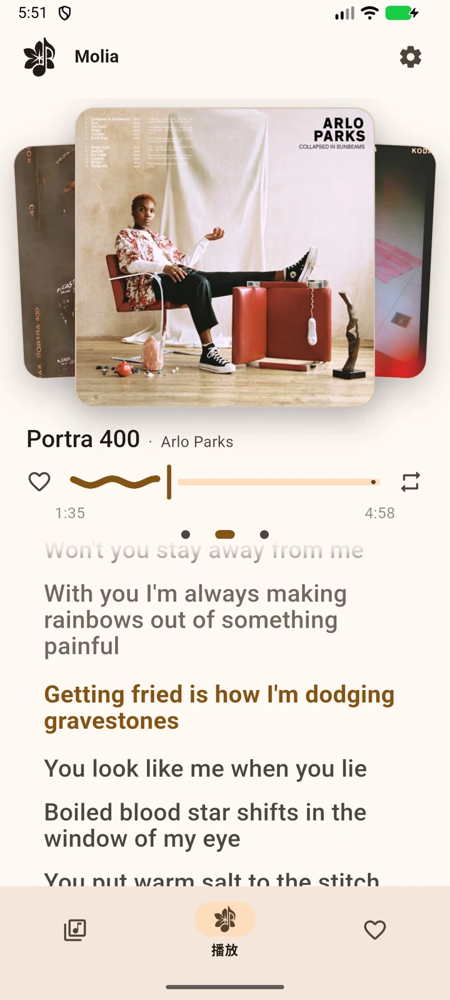
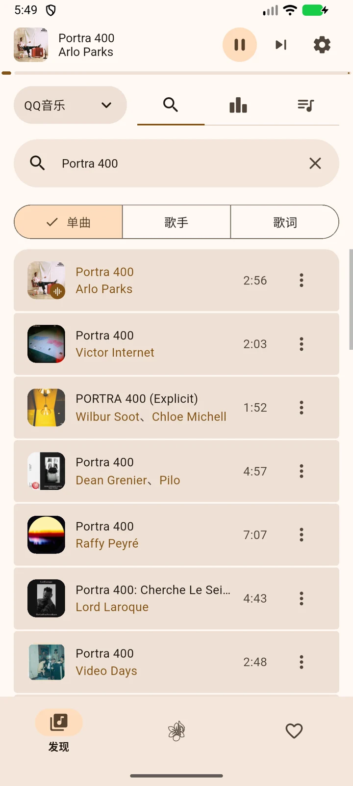
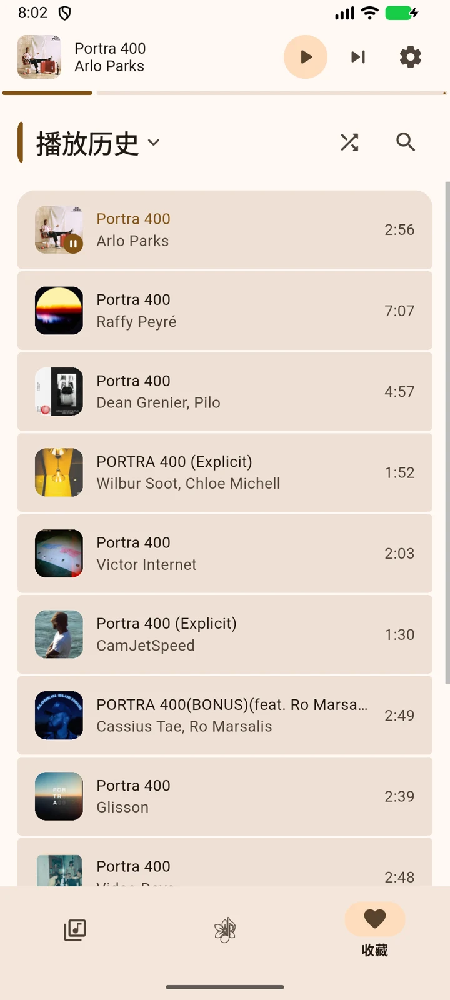
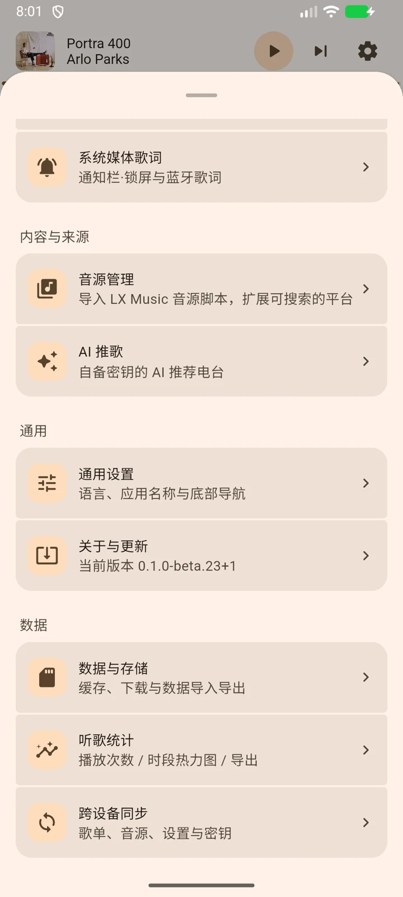
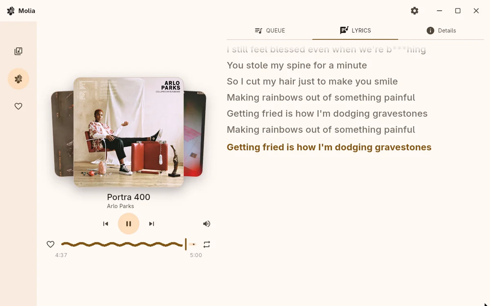

  

<h1 align="center">Molia</h1>

  多音源、本地优先的音乐播放器。把搜索、发现、播放、歌词和资料库放进一个界面， 
  数据留在你自己的设备上。

  
  
  
  
  

| 正在播放 | 搜索 | 发现歌单 |
| :---: | :---: | :---: |
|  |  |  |

Molia 是一个用 Flutter 写的音乐播放器：内置 QQ 音乐、网易云音乐、酷狗音乐、酷我音乐、咪咕音乐和哔哩哔哩六个平台，也支持导入 [LX Music](https://github.com/lyswhut/lx-music-desktop) 自定义音源脚本。

## 功能一览

### 一个播放器，接上你的音源

- **六个内置平台**：QQ 音乐、网易云音乐、酷狗音乐、酷我音乐、咪咕音乐与哔哩哔哩。五个音乐平台支持搜索、热榜、歌单、热门搜索、歌手页、专辑、评论和按歌词搜歌；哔哩哔哩支持视频搜索、CC 字幕歌词、UP 主页、音乐榜和公开收藏夹导入。
- **LX 音源脚本**：支持文件、粘贴和链接导入，启用 / 停用 / 排序、默认音质（默认 320K，自动降级）与 `@updateUrl` 一键更新。脚本在独立的 QuickJS isolate 中运行，崩溃后退避重启，连续失败才停用。
- **原生歌词与封面**：内置平台按平台 id 精确取词取图，包含逐字歌词、翻译和罗马音；脚本未提供歌词时自动回退到内置实现。
- **自动换源**：当前音源取链失败时，自动换到其它可播放的音源找同一首歌。

### 听歌这件事，应该更顺手

- 列表循环 / 顺序播放 / 单曲循环 / 随机播放，队列随时可看、可拖；
- 冷启动恢复上次的曲目、队列、模式和进度；启动即回到「上次听到哪里」；
- 后台播放、锁屏 / 通知栏 / 耳机键控制；Android 通知栏带「收藏」和「播放顺序」；
- 睡眠定时：倒计时（仅播放时计时）或「播完当前歌曲」；
- 下载与缓存管理，桌面端可把正在播放的流写入本地缓存；
- 省流模式：移动数据下自动压低音质、少加载封面，Wi-Fi 下恢复。

### 歌词

- 逐字染色 / 卡拉 OK 式滚动，支持翻译与罗马音双行；
- 手动滚动后暂停跟随，点一下回到当前行；
- 按歌词搜歌、换歌词源（本地下载曲目除外）；
- 桌面歌词（Windows / Linux）：悬浮窗、点击穿透 / 可交互、字号与配色可调；
- 歌词海报：选行、换字体、按封面或主题取色，导出分享图；
- 歌曲信息页可看封面、音质、来源、歌词来源、评论、专辑与歌手。

  
  

### 资料库

- 我的收藏、自建列表、播放历史；收藏与列表支持排序、搜索、批量操作；
- 本地音频导入，`.lxmc` 收藏导入，平台歌单 / 公开收藏夹链接导入；
- 自定义每首封面和全局默认封面，换封面不改动原文件；封面可随同步一起发送（默认关闭）；
- 听歌统计：播放次数、时长、曲目 / 歌手 / 平台榜单、日历热力图与作息热力图，可导出 JSON。

### AI 推歌（可选）

- 自带密钥接入 DeepSeek / OpenAI / 任意 OpenAI 兼容接口；
- 根据播放历史、收藏和偏好生成推荐，支持风格、场景、语言、年代、探索度等偏好；
- 推荐结果会自动在可搜索渠道里找歌，播完一批可继续补歌；
- 发送范围在每次生成前透明展示，API Key 存在系统安全存储，不进日志；功能默认关闭。

### 跨设备同步（可选）

- 两种传输：局域网直连（自动发现 + 一键配对）或自备 WebDAV；
- 同步内容可选：歌单与收藏、音源脚本与配置、设置、统计、播放历史、上次播放、自定义封面、AI 推歌与凭证；
- 同步口令就是信任根：快照整体加密（AES-256-GCM），不依赖云端账号；
- 冲突按版本戳合并，删除会传播墓碑；同步页能看到每轮的五态结论、变更量与日志。

### 桌面端

- Material 3 Expressive 界面，动态取色 / 跟随当前封面取色 / 纯黑背景 / 自定义字体；
- 常驻托盘（Linux / Windows / macOS 菜单栏）、关闭到托盘、托盘菜单控制播放；Windows 任务栏缩略图按钮；
- Linux MPRIS、Windows / macOS 系统媒体会话；全局快捷键；
- 应用内检查更新与安装（Android / Windows / Linux 便携版）；macOS 从发布页手动更新。

  

## 下载

所有安装包都在 [GitHub Releases](https://github.com/StillMisty/molia/releases) 发布。测试版会标记为 **Pre-release**。

| 平台 | 系统要求 | 产物 |
| :--- | :--- | :--- |
| Android | Android 15（API 35）及以上 | `molia-<version>-android-arm64.apk`、`armv7`、`x86_64`，或 `.aab` |
| Windows | Windows 10 / 11 x64 | `molia-<version>-windows-x64.zip`（便携版）或 `setup.exe`（安装版） |
| Linux | x64，需系统安装 `mpv` / `libmpv2` | `molia-<version>-linux-x64.tar.gz`，解压后可 `./install.sh` 安装桌面入口 |
| iOS | iOS 18 及以上，需自行签名 / 侧载 | `molia-<version>-ios-unsigned.zip`（无签名，仅供验证） |
| macOS | macOS 12 及以上（Apple Silicon / Intel 视构建机架构） | `molia-<version>-macos-<arch>-unsigned.zip`（ad-hoc 签名、未公证，仅供验证） |

> Android 的应用内更新需要允许「安装未知应用」；Linux 的托盘图标需要系统有 StatusNotifier 宿主（GNOME 需 AppIndicator 扩展），缺失时会自动降级为无托盘。macOS 不提供应用内更新：在「系统设置 › 隐私与安全性」放行首次打开后，后续版本从发布页手动下载覆盖。

## 数据与隐私

- 没有账号系统，默认不上传听歌数据；
- 收藏、列表、历史、统计保存在本机 SQLite；API Key 存系统安全存储；
- AI 推歌与跨设备同步默认关闭，开启前会展示数据发送范围 / 信任说明；
- 跨设备同步的快照整体加密，同步口令不会被明文上传；
- LX 音源脚本是第三方可执行代码：在隔离环境中运行、不暴露文件系统或平台通道，但脚本仍可发起网络请求，导入前请确认来源可信。

## 说明

- 本项目不提供、不托管任何音乐内容；搜索与播放的数据来自各平台公开接口或你导入的音源脚本，版权归原权利人所有。
- 请遵守所在地法律与各平台服务条款，仅将本项目用于学习与个人用途。
- 内置平台接口可能随平台调整而失效，欢迎提交 issue / PR 修复。

## 致谢

- [LX Music](https://github.com/lyswhut/lx-music-desktop)

## License

[CC BY-NC-SA 4.0](LICENSE) © 2026 Molia
