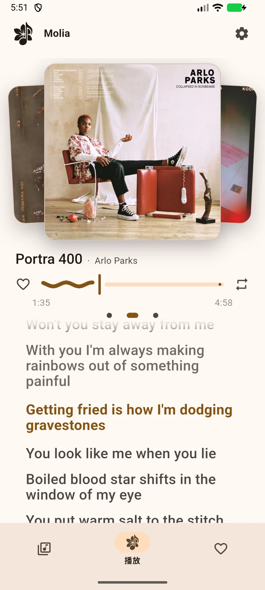
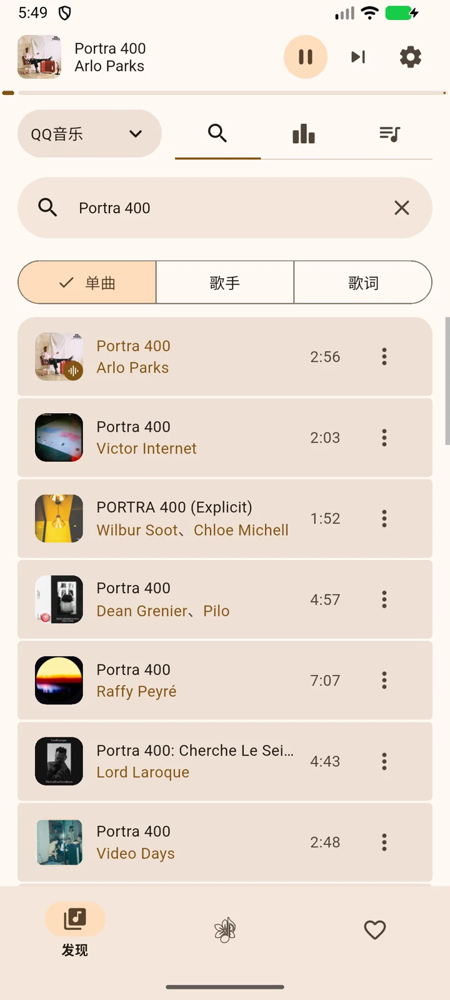
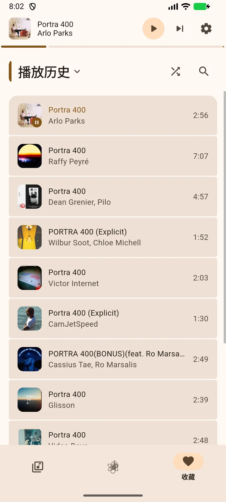
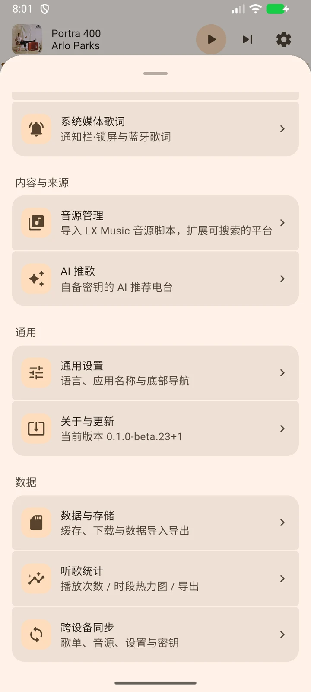
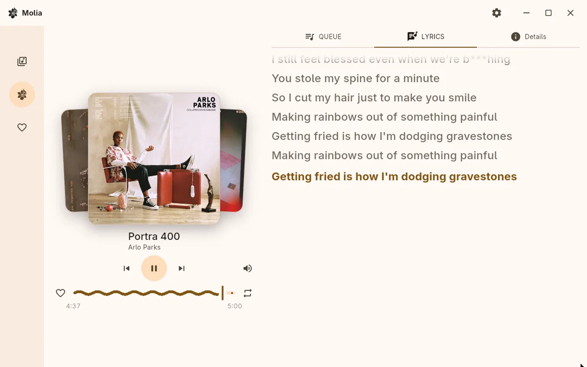

  

<h1 align="center">Molia</h1>

  多音源、本地优先的跨平台音乐播放器。 
  搜索、发现、播放、歌词与资料库集成于单一界面，数据默认保存在本机。

  
  
  
  
  

| 正在播放 | 搜索 | 发现歌单 |
| :---: | :---: | :---: |
|  |  |  |

Molia 基于 Flutter 开发，内置七个内容渠道，并支持导入 [LX Music](https://github.com/lyswhut/lx-music-desktop) 音源脚本。

## 功能

### 内容渠道与音源

- **七个内置渠道**：QQ 音乐、网易音乐、酷狗音乐、酷我音乐、咪咕音乐、汽水音乐与哔哩哔哩。前五个音乐平台支持搜索、热榜、歌单、热门搜索、歌手页、专辑、评论与按歌词搜歌；汽水音乐支持搜索、推荐歌单、歌手页、专辑、评论与逐字歌词，曲目链接由音源脚本提供，会员曲目匿名状态下仅可试听；哔哩哔哩支持视频搜索、CC 字幕歌词、UP 主页、音乐榜与公开收藏夹导入。
- **LX 音源脚本**：支持文件、粘贴与链接导入，可启用、停用与排序，可设置默认音质（默认 320K，失败时自动降级）。
- **歌词与封面**：内置平台按平台 id 精确匹配，支持逐字歌词、翻译与罗马音。歌词与封面优先取自曲目来源渠道，无法获取时按歌名严格匹配兜底。
- **自动换源**：当前音源取链失败时，自动切换至其它可播放音源的同曲目。

### 播放

- 支持列表循环、顺序播放、单曲循环与随机播放；播放队列可查看与拖拽调整。
- 冷启动时恢复上次的曲目、队列、播放模式与进度。
- 支持后台播放，以及锁屏、通知栏与耳机键控制；Android 通知栏提供收藏与播放顺序操作。
- 睡眠定时：1–120 分钟倒计时，仅播放时计时，可选择「本曲播完再停」。
- 提供下载与缓存管理；桌面端可将正在播放的流写入本地缓存。
- 省流模式：移动数据下自动降低音质并减少封面加载，切换至 Wi-Fi 后恢复。

### 歌词

- 逐字染色与滚动，支持翻译、罗马音双行显示。
- 手动滚动后暂停跟随，点击可回到当前行。
- 支持按歌词搜歌与更换歌词源（本地下载曲目除外）。
- 桌面歌词（Android 悬浮窗）：支持点击穿透与交互，字号与配色可调。
- 歌词海报：可选行、更换字体、按封面或主题取色，并导出分享图。
- 歌曲信息页展示封面、音质、来源、歌词来源、评论、专辑与歌手。

### 资料库

- 提供收藏、自建列表与播放历史；收藏与列表支持排序、搜索与批量操作。
- 支持导入本地音频、`.lxmc` 收藏，以及平台歌单与公开收藏夹链接。
- 支持为单曲设置封面与全局默认封面，更换封面不改动原文件；封面可随同步发送。
- 听歌统计：播放次数、时长、曲目 / 歌手 / 平台榜单、日历与作息热力图，支持导出 JSON。

  
  

### 可选服务

- **AI 推歌**：使用自有密钥接入 DeepSeek、OpenAI 或任意 OpenAI 兼容接口；依据播放历史、收藏与偏好生成推荐，可按风格、场景、语言、年代与探索度限定；推荐曲目自动在可搜索渠道中匹配，可连续补充。API Key 仅保存在本机凭据库，不写入日志。
- **听歌同步**：可连接 ListenBrainz 或 Last.fm。开启后仅发送歌名、歌手、专辑、时长与开始播放时间，不上传本地文件路径、歌单内容与设备标识。
- **跨设备同步**：支持局域网直连（自动发现与一键配对）或自备 WebDAV。可同步收藏与歌单、音源脚本与配置、设置、统计、播放历史、上次播放、自定义封面、AI 推歌配置与凭证。快照整体加密（AES-256-GCM），不以云端账号作为信任根；冲突按版本戳合并，删除通过墓碑传播，同步页展示每轮结论、变更量与日志。
- AI 推歌与跨设备同步默认关闭，开启前会展示数据发送范围与信任说明。

### 桌面端

- Material 3 Expressive 界面；支持动态取色、跟随当前封面取色、纯黑背景与自定义字体。
- 常驻托盘（Linux / Windows / macOS 菜单栏），支持关闭到托盘与托盘菜单控制播放；Windows 提供任务栏缩略图按钮。
- 支持 Linux MPRIS、Windows / macOS 系统媒体会话与全局快捷键。
- 支持应用内检查更新与安装（Android、Windows、Linux 便携版）；macOS 需从发布页手动更新。

  

## 下载

所有安装包均在 [GitHub Releases](https://github.com/StillMisty/molia/releases) 发布，测试版标记为 **Pre-release**。

| 平台 | 系统要求 | 发布产物 |
| :--- | :--- | :--- |
| Android | Android 15（API 35）及以上 | `molia-<version>-android-arm64.apk`（另有 `armv7`、`x86_64`）或 `.aab` |
| Windows | Windows 10 / 11 x64 | `molia-<version>-windows-x64.zip`（便携版）或 `setup.exe`（安装版） |
| Linux | x64，系统需安装 `mpv` / `libmpv2` | `molia-<version>-linux-x64.tar.gz`，解压后可运行 `./install.sh` 安装桌面入口 |
| iOS | iOS 18 及以上，需自行签名或侧载 | `molia-<version>-ios-unsigned.zip`（无签名，仅供验证） |
| macOS | macOS 12 及以上，架构取决于构建机 | `molia-<version>-macos-<arch>-unsigned.zip`（ad-hoc 签名，未公证，仅供验证） |

- Android 应用内更新需允许「安装未知应用」。
- Linux 托盘需要 StatusNotifier 宿主（GNOME 需安装 AppIndicator 扩展），缺失时降级为无托盘。
- macOS 不提供应用内更新；首次打开需在「系统设置 › 隐私与安全性」中放行，后续版本从发布页下载覆盖。

## 数据与隐私

- 用户数据默认仅保存在本机：收藏、列表、历史与统计存于本机 SQLite；AI Key、听歌同步 Token、哔哩哔哩登录信息与同步口令存于本机凭据库。凭据库为明文 SQLite，不依赖系统钥匙串，能够访问本机数据目录或备份文件的人员亦可读取。
- 哔哩哔哩账号登录为可选项，仅用于读取字幕歌词；播放、搜索、评论与字幕 CDN 请求均保持匿名。
- 跨设备同步的快照整体加密，同步口令不以明文上传；哔哩哔哩登录信息属于凭证，随快照加密同步。
- 完整备份默认包含全部凭证与用户数据，备份文件为明文 JSON，请妥善保管。窗口位置、缓存策略、字体等设备相关设置与本机缓存文件不在备份范围内。
- LX 音源脚本属于第三方可执行代码：运行于隔离环境，不暴露文件系统与平台通道，但仍可发起网络请求，导入前请确认来源可信。

## 许可

本项目代码以 [Apache License 2.0](LICENSE) 授权，允许商业使用、修改与再分发，须保留版权与许可声明。

本项目不提供、不托管任何音乐内容：搜索与播放的数据来自各平台公开接口或用户导入的音源脚本，版权归原权利人所有。平台接口可能随平台调整而失效；使用本软件时请遵守所在地法律与各平台服务条款。

## 致谢

- [LX Music](https://github.com/lyswhut/lx-music-desktop)
